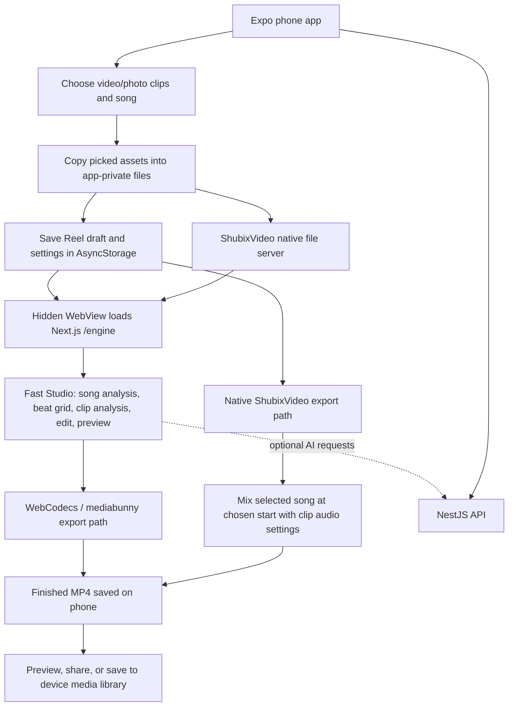

# Shubix architecture: start to finish

This diagram follows the actual code paths for the web app, phone app, reel creation, audio, AI assistance, export, and cloud save. It is an architecture overview, not a deployment or security review.

## System overview

```mermaid
flowchart LR
  subgraph Clients[Client applications]
    Web[Next.js web app\nFE/web-app]
    Mobile[Expo phone app\nFE/mobile-app]
    BrowserEngine[Fast Studio\nWeb Audio + WebCodecs + Canvas/WebGL]
    NativeEngine[ShubixVideo native module\nphone MP4 export]
    MobileWebView[Hidden WebView\nloads web app /engine]
    LocalFiles[Browser files / IndexedDB\nPhone private files + AsyncStorage]
  end

  subgraph Shared[Shared workspace packages]
    SharedCore[@shubix/core\nengine helpers, templates, plans]
    SharedSchemas[@shubix/types + validations\nAPI types and Zod schemas]
    ApiClient[@shubix/api-client + hooks\nweb cookie / phone Bearer token]
    SharedUI[ui-web / ui-mobile / ui-core]
  end

  subgraph API[BE/api · NestJS]
    RouteAdapter[RouteTable + RoutingController\n117 web-style route handlers]
    NativeModules[Native Nest modules\nauth + users]
    Domain[Server services\nstudio, media, billing, accounts, content, admin]
    AI[AI provider layer\nconfigured remote providers or Ollama]
    Media[FFmpeg / ffprobe\nserver-side media utilities]
  end

  subgraph Data[Persistent services]
    Mongo[(MongoDB\nusers, projects, media, saved Reel metadata, settings)]
    R2[(Cloudflare R2 / mounted storage\nsource media and saved MP4 files)]
    Disk[(Local storage + scratch\nlocal deployments / temporary render work)]
  end

  Web --> BrowserEngine
  Mobile --> MobileWebView
  MobileWebView --> BrowserEngine
  Mobile --> NativeEngine
  BrowserEngine <--> LocalFiles
  NativeEngine <--> LocalFiles
  Web --> SharedUI
  Mobile --> SharedUI
  Web --> SharedCore
  Mobile --> SharedCore
  Web --> ApiClient
  Mobile --> ApiClient
  ApiClient -->|/api/*; web same-origin rewrite, phone direct API| RouteAdapter
  RouteAdapter --> NativeModules
  RouteAdapter --> Domain
  Domain --> AI
  Domain --> Media
  Domain --> Mongo
  Domain --> R2
  Domain --> Disk
  BrowserEngine -. structured edit context / AI requests .-> API
  BrowserEngine -->|finished MP4 only, optional cloud save| R2
```

## Web reel flow: clips and song to final video

```mermaid
sequenceDiagram
  autonumber
  actor Creator
  participant UI as Next.js Create / Studio
  participant Engine as Browser Fast Studio
  participant Files as Browser memory / local files
  participant API as NestJS API
  participant Director as AI provider (optional)
  participant Encoder as WebCodecs + mediabunny
  participant Store as Download / My Reels storage
  participant DB as MongoDB metadata

  Creator->>UI: Open Create (music/talking/photo/copy) or Studio
  UI->>Engine: Mount FastStudio and initialize editor
  Creator->>Engine: Select video clips and a song
  Engine->>Files: Read clip and song files in the browser
  Engine->>Engine: Decode song with Web Audio; find tempo, beats, drops and breaks
  Engine->>Engine: Read clips; score motion, scenes, sharpness and faces
  opt AI Director, variants, translation, captions or other server feature
    Engine->>API: Send prompt and structured analysis/context (specific endpoints)
    API->>Director: Request a bounded response for the configured task
    Director-->>API: Structured result
    API-->>Engine: Edit suggestions / text / translations
  end
  Engine->>Engine: Build beat-aligned edit; preview transitions, effects, text and sound
  Engine->>Encoder: Render frames and mixed audio in browser
  Note over Engine,Encoder: Song is mixed locally into the rendered MP4; it is not uploaded as a source file for rendering.
  Encoder-->>Engine: MP4 H.264 + AAC (or WebM fallback)
  Engine->>Store: Save/download finished video on this device
  opt Creator chooses Export & save to My Reels
    Engine->>API: Create saved-Reel record and request upload plan
    API->>DB: Store owner-scoped metadata with uploading status
    API-->>Engine: Presigned R2 multipart URLs (or local upload URL)
    Engine->>Store: Upload finished MP4 parts directly to R2
    Engine->>API: Complete upload with part ETags
    API->>Store: Join/check uploaded file
    API->>DB: Mark Reel ready
  end
```

### Audio specifically

- **Web:** The selected song remains in browser memory for analysis and preview. Fast Studio creates an offline audio mix during export, applies its gain/limiter/fades, and encodes AAC alongside the video frames. The resulting MP4 contains the audio track. Choosing **Export without the song** deliberately omits the song track (while retaining voice/voiceover where supported) so a song can be added later in Instagram.
- **Phone:** The picked song is copied into the app's private project folder and its URI is kept with the draft in AsyncStorage. The native export spec passes `{ uri, start }` for that audio to the ShubixVideo module, which produces the MP4 on-device. When the phone is using Fast Studio through its hidden WebView, it uses the same browser editor/export implementation; the phone file server exposes local media to that engine.
- **Cloud:** The normal “My Reels” save is the completed video upload. The source audio does not need to be uploaded separately for this step. The web client sends the MP4 directly to presigned R2 part URLs when R2 is configured; the API records and completes the saved-Reel entry. With no R2 configuration, the API accepts the file into configured local storage.
- **Server-assisted audio features:** Some optional features send audio-derived data or audio to the API (for example transcription sends WAV; caption or AI endpoints receive their task input). That is separate from the browser's ordinary render path.

## Phone reel flow



The app's editor routes eligible studio edits back into the hidden Fast Studio engine; when the phone draft contains changes that the engine cannot represent, its native ShubixVideo renderer is used instead. Creating Reels needs the installed Shubix app build; the phone code explicitly says Expo Go does not include the native video module.

## API and service boundaries

- **Web UI:** Next.js App Router pages and React UI. `/api/*` is rewritten to the Nest API so browser requests stay same-origin and use the `reel_session` cookie.
- **Phone UI:** Expo Router. It calls the same API through the shared API client, with a Bearer token stored in SecureStore. A hidden WebView loads the web `/engine` for the shared Fast Studio implementation.
- **API:** NestJS starts with raw request-body parsing disabled so handlers can stream large uploads. A route table discovers `BE/api/src/routes/**/route.ts`; native Nest auth/users modules handle their routes, and the catch-all adapter dispatches the remaining handlers. The repo currently contains 117 route handler files.
- **AI:** Studio AI requests go through server-side studio handlers and a provider abstraction. Depending on configuration, providers include local Ollama or remote providers. The local browser beat/clip analysis and final browser render do not require an AI provider.
- **Media:** Browser Fast Studio does the interactive edit and its normal final render on-device. The API's separate media services use FFmpeg/ffprobe for upload validation, facts/thumbnails, and server-side media work.
- **Persistence:** MongoDB stores user-scoped records and metadata; project/media/file bytes are stored under configured storage keys. Cloud deployments mount R2 for saved Reels and use scratch space for temporary work. The exact saved file location depends on deployment configuration.
- **Deployment:** The main Docker image runs the API on port 4000 and Next.js on port 3000 in one container. Next rewrites `/api` to the API. Cloudflare Worker/Container and R2 configuration are present; local development runs web on 3001 and API on 4000.

## Main code landmarks

| Concern | Code location |
|---|---|
| Web app and Fast Studio mount | `FE/web-app/app`, `FE/web-app/components/studio/FastStudio.tsx` |
| Browser editing, audio mix, export | `FE/web-app/components/studio/engine.ts` |
| Web `/api` proxy and isolation headers | `FE/web-app/next.config.ts` |
| Shared web/phone API client | `Shared/api-client/src/index.ts` |
| Phone app and local drafts | `FE/mobile-app/app`, `FE/mobile-app/lib/projects.ts` |
| Phone hidden browser engine bridge | `FE/mobile-app/lib/engine.tsx`, `FE/web-app/components/studio/bridge.ts` |
| Native phone export/audio input | `FE/mobile-app/lib/video.ts`, `FE/mobile-app/modules/shubix-video` |
| API startup and route adapter | `BE/api/src/main.ts`, `BE/api/src/routing` |
| AI Studio director | `BE/api/src/routes/api/studio/direct/route.ts`, `BE/api/src/server/studio/direct.ts`, `BE/api/src/server/ai` |
| Saved Reel upload/lifecycle | `FE/web-app/lib/cloudReels.ts`, `BE/api/src/server/studio/reels.ts`, `BE/api/src/server/storage/r2.ts` |
| Database/storage configuration | `BE/api/src/server/core/db.ts`, `BE/api/src/server/storage`, `BE/api/src/server/core/config.ts` |
| Container deployment | `infra/docker`, `infra/cloudflare` |

## Reading this diagram

There are two distinct outputs paths: the browser makes a final video locally, and the optional cloud-save flow uploads that finished video. The backend is used for account data, AI-backed features, saved-Reel metadata, and storage coordination; it is not the normal web render worker. This reflects the current code structure, including the separate native renderer on the phone.
